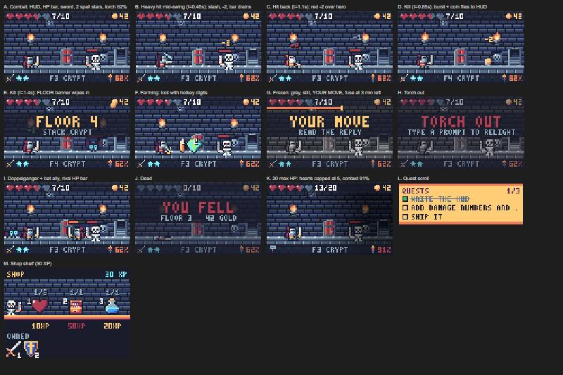

# Claude's Depths

A pixel-art roguelite dungeon crawl that lives in a side pane of the **Claude Code desktop app**, driven
by what Claude is doing. Claude's tool calls charge your energy, the tools it picks forge your weapon,
its subagents fight beside you (or against you), compaction quakes the dungeon, and the game freezes
while you read Claude's reply.

Goal: make the wait while Claude works fun, and keep your attention on Claude Code instead of another tab.



*The states above are drawn by `hooks/scene.ts` itself (combat, heavy hit, hit back, kill, floor banner,
farming, frozen, torch out, ally + doppelganger, death, capped hearts, quest scroll, shop).*

---

## Contents

- [Requirements](#requirements)
- [Install and run](#install-and-run)
- [How to play](#how-to-play)
- [How Claude drives the game](#how-claude-drives-the-game)
- [Game rules in numbers](#game-rules-in-numbers)
- [How it works](#how-it-works)
- [Project layout](#project-layout)
- [Development](#development)
- [Status and known issues](#status-and-known-issues)
- [Roadmap](#roadmap)
- [Credits](#credits)

## Requirements

- Claude Code with plugin (mod) support, run from the **desktop app**. Built and tested against
  Claude Code 2.1.293–2.1.295. Other surfaces (terminal, IDE, mobile) show a one-line "desktop only" notice.
- Node.js, only for the sprite tooling in `tools/`.
- No API keys. Flavor lines and shop stock use Claude Haiku through Claude Code's own model access
  (`$.model.complete`), capped per day, with hand-written fallbacks. `/delve haiku off` turns the
  calls off entirely, so the game spends no tokens.

## Install and run

At the prompt of a terminal `claude` session:

```
/plugin install delve --marketplace icyyolo/delve
```

Answer `y` to add the marketplace, then pick a scope (user scope loads it in every session, the
desktop app's Code tab included). The command is not available inside the desktop app itself, so run it
from a terminal once.

The **Claude's Depths** pane opens by itself when the session starts.

**From source** (for development):

```bash
git clone https://github.com/icyyolo/delve.git
```

```bash
claude --plugin-dir ./delve
```

To load a source checkout in every session, add the folder to `CLAUDE_CODE_PLUGIN_DIRS`.

| Command | Does |
|---|---|
| `/delve` | Open the pane (turns the game back on if it was off) |
| `/delve off` | Close the pane and keep it off across restarts |
| `/delve shop` | Turn the pane to the shop and print the wares as text |
| `/delve buy <id>` | Buy a ware with XP, e.g. `/delve buy vitality` |
| `/delve haiku [on\|off]` | Toggle Haiku flavor lines and shop picks; off = no model calls, built-in tables instead (kept across restarts) |

## How to play

The pane shows one room: the warrior on the left, a monster on the right, a HUD around the edge.

```
 ♥♥♥♥♡ 7/10                          ● 42     ← hearts + HP, gold
 [torch]                         [torch]
   warrior   loot(1)(2)     ▬▬▬▭ skeleton      ← HP bar over each foe
 ⚔ ★★          F3 CRYPT            🔥 62%      ← weapon, free swings, floor, context fill
```

| Key (pane focused) | Action |
|---|---|
| `A` | Attack: costs 1 energy, or free while a spell lasts |
| `1` `2` `3` | Grab that loot drop (numbers are drawn above the drops) / buy that ware in the shop |
| `S` | Open the shop |
| `B` | Back from the shop |
| `N` | Start a new run after death |

- **Hover** the hero, monsters, ally, doppelganger, loot or any HUD icon for a tooltip (name, HP, what the weapon does, context %).
- **Energy and XP** live in the Claude Code status line (`Depths · energy 5 · XP 12 · torch 4m`), so tool calls
  never redraw the pane.
- One line of text sits under the picture: an event (trap, quake, ally hit, the fall) or else the room's Haiku line.
- Plain hits and kills need no words: damage numbers pop up, the foe's HP bar drains, a slain monster bursts,
  its gold flies into the HUD, and a `FLOOR N` banner wipes in.

## How Claude drives the game

| Claude does | In the depths |
|---|---|
| Any tool call | +1 energy (soft cap 20 per turn; past it, energy becomes XP) |
| 3 s with no tool call (a plain Q&A turn, or Claude thinking between calls) | The hero farms: a loot drop every 4 s, each grabbable for 7 s |
| A monster dies | One loot drop on the spot |
| Edit / Write / NotebookEdit | **Sword**: +1 damage |
| Bash / PowerShell | **Hammer**: every swing crits. A failed command drops it (back to fists) |
| Read / Grep / Glob | **Bow**: the monster cannot hit back |
| WebFetch / WebSearch | **Portal**: each swing pulls a loot drop through |
| An MCP tool call | A familiar strikes the monster for 1, free |
| A skill (typed or via the Skill tool) | A spell: the next 3 swings cost no energy |
| A forked subagent | A rival **doppelganger** steps in front of the monster. It strikes you for 1 every 4 of its tool calls (never below 1 HP) and takes your swings first. Beat it for gold and XP equal to its max HP; if its run ends first, it walks off |
| Any other subagent | An **ally** joins behind you (Explore = bat, Plan = wraith, general-purpose = skeleton, other = mimic). When its run ends it strikes the monster for 1 + 1 per 3 of its tool calls (max 6) |
| Compaction | A quake: the room shakes and the hero drops a floor |
| Context filling up | The torch dims past 50% full, up to 80% dark at 100% |
| Turn ends | The room freezes (grey, still, `YOUR MOVE`) and a 5-minute torch fuse starts burning |
| Turn ends by Esc | You flee and drop a quarter of your gold |
| Turn ends by an error | A trap springs: -1 HP (never fatal) |
| Turn ends by a refusal | The monster raises its guard: +2 HP |
| Todo list (TodoWrite / TaskCreate / TaskUpdate) | Shown as a quest scroll; each finished item pays 5 gold + 3 XP |

**Read gate and torch.** Reading time for a reply is its words ÷ 250 wpm ÷ 2, clamped to 3 s–2 min.
Send your next prompt after that and before the torch burns out (5 min) for **+3 energy (momentum)**.
Drift past 5 minutes and the torch goes out: the monster gets one free hit.

## Game rules in numbers

**Hero.** 10 HP (+2 per Vitality level). A swing hits for 1, a crit doubles it to 2 (20% chance, +10% per
Whetstone), then the weapon bonus is added. A surviving monster hits back 50% of the time (-10% per Shield)
for its attack. A kill heals 1 HP, pays its gold and opens the next floor. HP 0 ends the run.

**Monsters.** HP grows +1 every 2 floors.

| Monster | HP | Attack | Gold | From floor | Needs |
|---|---|---|---|---|---|
| Slime | 4 | 1 | 2 | 1 | |
| Bat | 5 | 1 | 2 | 1 | |
| Skeleton | 7 | 2 | 4 | 3 | |
| Wraith | 8 | 2 | 5 | 5 | |
| Mimic | 9 | 2 | 8 | 6 | Deep dwellers |
| Golem | 12 | 3 | 8 | 8 | Deep dwellers |

**Biomes.** Stack Crypt, and Heap Caverns once unlocked (they then alternate every 5 floors).

**Loot.** Coin 1–3 gold · XP gem +3 XP · red potion +2 HP · blue potion +2 energy (unlock) · loot bag 5–8 gold (unlock).

**Doppelganger HP** by the model it runs on: Opus 10, Sonnet 7, Haiku 4, other 6.

**Shop.** Runs last until death; XP buys permanent wares. A level costs base × (current level + 1) XP. Each new
run, Claude Haiku picks 3 wares and a one-line pitch (8 s timeout; dice pick if it fails or answers off-list).

| Ware | Effect | Max level | Base price |
|---|---|---|---|
| Vitality | +2 max HP | 5 | 10 XP |
| Whetstone | +10% crit chance | 3 | 15 XP |
| Shield | -10% chance to be hit back | 3 | 15 XP |
| Blue potion | blue potions drop while farming | 1 | 20 XP |
| Loot bag | loot bags drop while farming | 1 | 20 XP |
| Heap Caverns | unlocks the second biome | 1 | 40 XP |
| Deep dwellers | mimics and golems appear | 1 | 50 XP |

**Flavor.** One Haiku line per room (4 s timeout, at most 120 characters), with 3 hand-written lines per
monster as the fallback. Haiku calls (flavor + shop) are capped at 200 per UTC day, and `/delve haiku off` stops them.

## How it works

The plugin is one hooks module (`hooks/register.tsx`) registered through `hooks/hooks.json`.

**Events it listens to**

| Event | Used for |
|---|---|
| `session.start` | Register `/delve`, load the saved run, re-arm the torch, open the pane |
| `turn.start` | Unfreeze, check the read gate (momentum), start the 3 s farm timer (re-armed after every tool call) |
| `tool.call` | +1 energy, forge the weapon, summon a familiar, track the quest board; a subagent's calls count toward its own fight. Fails open: a game error never blocks a tool |
| `agent.spawn` | Add an ally or a doppelganger |
| `session.compact` | Quake |
| `skill.prompt` | Cast a spell |
| `turn.complete` | Freeze, start the torch, apply how the turn ended, read context fill; settle a finished subagent |
| `command.run` | `/delve` and its sub-commands |
| `ui.render` (Pane) | Draw the pane |

**State.** Values live in plugin session state (`atom` / `read` / `update`); writing one redraws only the
parts of the pane that read it. The run, purse, meta upgrades, shop and flavor line are also written to the
plugin store so they survive restarts. The pane never reads the purse (energy changes on every tool call),
so tool calls do not redraw it.

**Rendering.** All art is 16×16 palette-indexed sprite grids (`assets/sprites/*.json`, Sweetie 16 palette)
turned into SVG `<path>` runs, one path per colour. The pane is a single interactive `Svg`, plus a quest
scroll `Svg` and a shop `Svg`. Animation is **SVG SMIL only**: the pane never redraws on a timer, because
clock-driven redraws made the desktop cursor flicker. A hit's animation (swing, flinch, damage number, burst,
banner) is baked into the SVG it produces and plays once. A 3×5 pixel font and HUD mini icons are drawn in
code in `hooks/scene.ts`. Every `Svg` has an `alt` that carries all the text it replaces.

**Pure rules.** Combat (`combat.ts`), Claude mapping (`claude.ts`), shop (`shop.ts`) and flavor (`flavor.ts`)
are pure functions that take a dice function, so tests can fix the dice.

## Project layout

```
.claude-plugin/plugin.json   plugin manifest
hooks/hooks.json             points Claude Code at the hooks module
hooks/register.tsx           event hooks, state, timers, pane layout
hooks/scene.ts               SVG drawing: room, HUD, effects, pixel font, quest scroll, shop shelf
hooks/combat.ts              combat rules (pure)
hooks/claude.ts              how Claude's work maps to the game (pure)
hooks/shop.ts                meta shop rules, Haiku shop prompt and parsing (pure)
hooks/flavor.ts              Haiku flavor prompt and parsing, fallback table
hooks/sprites.gen.ts         GENERATED from assets/ by tools/sprites.mjs, do not edit
types/index.d.ts             state contract (every value the plugin keeps)
tests/delve.test.tsx         40 tests
tools/sprites.mjs            sprite validator, PNG contact sheets, preview page, generator
assets/                      palette, sprite manifest, style brief, sprite JSON, previews
docs/gallery.jpg             rendered pane states
PLAN.md                      spec, checkpoints and full build log
```

## Development

```bash
claude plugin validate .
```

```bash
claude plugin test .
```

```bash
node tools/sprites.mjs check
```

`check` validates every sprite against `assets/manifest.json` and writes PNG contact sheets to `assets/preview/`.
After editing sprites, regenerate the module the plugin imports:

```bash
node tools/sprites.mjs build
```

Type-checking needs `.claude-plugin/types/`, which Claude Code generates the first time it loads the
plugin (it is git-ignored):

```bash
npx -y -p typescript@5.6.3 tsc -p .
```

**Current results:** validate passes (one warning: no author field, left out on purpose), 40/40 tests pass,
sprite check passes, the largest scene is about 91k of the 131k-character `Svg` limit.

## Status and known issues

- **Verified:** tests, validate, type-check, sprite check, and every pane state rendered by the plugin's own
  drawing code in a browser (the gallery above). **Not yet verified in the live desktop pane:** tooltips,
  hotkeys and layout width.
- **Effects may replay on redraw.** A redraw sends a new SVG, which likely restarts the last hit's one-shot
  animations (for example, every 4 s loot drop while farming).
- **`/delve buy` does not check the max level.** Two quick presses on the same ware can buy past its max.
- **Saves can go out of order.** Two game events at once can write the store in the wrong order; the older
  value can win after a restart.
- **Some hooks are not fail-open yet.** `tool.call`, `agent.spawn`, `session.compact` and `skill.prompt` fall
  through to Claude on error; `session.start`, `turn.start`, `turn.complete` and `command.run` do not.
- **Saved data is merged, not validated** on load.
- **A subagent that never reports its end** leaves its ally or doppelganger in the room.
- **Several sessions** share one store: last write wins.

## Roadmap

1. Stamp each hit with a time and skip stale one-shot animations.
2. Max-level guard in `buy`.
3. Serialise run and store writes.
4. Fail-open on every hook.
5. Validate and version saved data; add `/delve reset` and `/delve debug`.
6. Clear orphan fighters at turn end and session start.
7. Swappable dice in `register.tsx` and randomized invariant tests for the pure rules.
8. CI: validate, tests and sprite check on every push.
9. Gameplay: weapon drawn in the hero's hand, bought gear on the hero, ambient effects, a boss every 5 floors,
   death summary with best run, combo counter, scene scaled to the pane width.

## Credits

- Palette: [Sweetie 16](https://lospec.com/palette-list/sweetie-16) by GrafxKid.
- Built with Claude Code.
