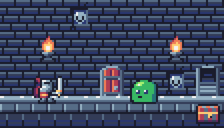

# Claude's Depths

A pixel-art roguelite dungeon crawl that lives in a side pane of the Claude Code desktop app.
A lone warrior fights its way down a dungeon, and the fight is driven by what Claude is doing:
Claude's tool calls charge your energy, the tools it uses forge your weapon, its subagents join
the fight, and the game freezes while you read Claude's reply.



Built as a Claude Code plugin (mod) named `delve`. Desktop app only; other surfaces show a one-line notice.

## Install

Load the folder as a plugin directory when starting Claude Code:

```bash
claude --plugin-dir /path/to/this/repo
```

The pane opens by itself when a session starts.

## Commands

| Command | Does |
|---|---|
| `/delve` | Open the pane (and turn the game back on) |
| `/delve off` | Close the pane and keep it off across restarts |
| `/delve shop` | Open the shop view and print the wares |
| `/delve buy <id>` | Buy a ware with XP |

## Controls (pane focused)

| Key | Action |
|---|---|
| `A` | Attack (1 energy, or free during a spell) |
| `1`–`3` | Grab a loot drop / buy a ware in the shop |
| `S` | Open the shop |
| `B` | Back from the shop |
| `N` | New run after death |

Hover the hero, monsters, loot and HUD icons for tooltips.

## How Claude drives the game

- **Energy**: each tool call Claude makes gives 1 energy (soft cap 20 per turn; extra turns into XP).
  Energy and XP show in the status line.
- **Farming**: a turn with no tool call after 3 s makes the hero farm; loot drops every 5 s and can be grabbed for 3 s.
- **Freeze**: when Claude's turn ends the room greys out and waits. Reading the reply before sending the
  next prompt earns +3 energy; drifting more than 5 minutes burns the torch out and the monster ambushes once.
- **Weapons**: Claude's last tool forges the hero's weapon. Edit/Write = sword (+1 damage),
  Bash/PowerShell = hammer (sure crit; a failed command drops it), Read/Grep/Glob = bow (no hit back),
  WebFetch/WebSearch = portal (each swing drops loot). An MCP tool call summons a familiar for one free hit.
- **Subagents**: a forked subagent becomes a rival doppelganger that strikes you while it works; beat it for
  gold and XP. Any other subagent joins as an ally monster and strikes when its run ends.
- **Compaction** quakes the dungeon and drops the hero a floor. **Context fill** dims the torch.
- **Turn endings**: Esc flees (drops a quarter of the gold), an error springs a trap (-1 HP, never fatal),
  a refusal lets the monster raise its guard.
- **Skills** are spells: the next 3 swings cost no energy.
- **Quests**: Claude's own todo list shows as a quest board; each finished item pays gold and XP.
- **Flavor**: Claude Haiku writes a line for each room (with a daily cap and a hand-written fallback table),
  and stocks the meta shop.

## Progression

Runs persist across sessions until the hero dies. XP buys permanent upgrades in the shop: Vitality
(+2 max HP), Whetstone (+10% crit), Shield (-10% chance to be hit back), and unlocks (blue potions,
loot bags, the Heap Caverns biome, deep-dwelling mimics and golems).

## Project layout

```
.claude-plugin/plugin.json   plugin manifest
hooks/hooks.json             points Claude Code at the hooks module
hooks/register.tsx           event hooks, state, pane rendering
hooks/scene.ts               SVG drawing: room, HUD, effects, pixel font, quest scroll, shop shelf
hooks/combat.ts              combat rules (pure)
hooks/claude.ts              how Claude's work maps to the game (pure)
hooks/shop.ts                meta shop rules (pure)
hooks/flavor.ts              Haiku flavor lines + fallback table
hooks/sprites.gen.ts         generated from assets/ by tools/sprites.mjs
types/index.d.ts             state contract
tests/delve.test.tsx         tests
tools/sprites.mjs            sprite validator, contact sheets, preview page, generator
assets/                      palette, sprite manifest, style brief, sprite JSON, previews
PLAN.md                      spec, checkpoints and build log
```

## Rendering notes

All art is 16x16 palette-indexed sprites turned into SVG paths. Animation is SVG SMIL only: the pane
never redraws on a timer (clock-driven redraws made the desktop cursor flicker), so it redraws only on
game events.

## Development

```bash
claude plugin validate .
claude plugin test .
node tools/sprites.mjs check
node tools/sprites.mjs build
```

Type-checking (`tsc -p .`) needs `.claude-plugin/types/`, which Claude Code generates the first time it
loads the plugin; it is git-ignored.

## Credits

Palette: [Sweetie 16](https://lospec.com/palette-list/sweetie-16) by GrafxKid.
